# BASS-II flame spread: detection, measurement and forecasting

_Generated by `python -m bass2.report` from pipeline outputs. NASA PSI-25 (DOI 10.60555/4qc4-de67, CC0)._

## 1. Question
Can flame spread in the ISS BASS-II videos be detected and measured automatically, accurately enough to reproduce published spread rates, and can the measured time series be forecast?

## 2. Data
- 83 tests processed (main side-view camcorder video, 720×480 @ 29.97 fps, SAR 10:11): thin PMMA films (B), thick slabs (M), rods (O, P), SIBAL fabric and spheres (T), Nomex and candle (F).
- Test conditions from the cleaned experimental table, cross-checked against the NASA as-run matrices.
- Telemetry (AIR velocity, FAN voltage, RAD radiometer, clock) read by OCR from the burned-in OSD.
- Data defects: the B14, B18 and B20 main MP4 files are truncated on the NASA server (no `moov` atom) and were replaced by their original MPEG-TS recordings; M3 has only a rack-camera video recorded during loss of signal.

## 3. Method (summary)
1. Frames masked (OSD band, illuminated frames, static artefacts such as LEDs and hot pixels). The flame is segmented by hysteresis thresholds relative to each frame's background noise (median + k·MAD) on max(RGB), OR-ed with a blue-excess channel so faint blue leading edges are kept.
2. Sub-pixel leading/trailing edges from the intensity-weighted profile along the spread axis; isolated edge outliers removed with a Hampel filter.
3. Spatial calibration from the duct's ruler in illuminated frames (1 cm marks): fixed-FOV camera scale 0.2093 mm/px (0.8 % spread between 12 rulers, 2 % allowance for depth).
4. The leading edge is median-binned and split into linear regimes by optimal segmentation; steady V_f = Theil-Sen slope of the **longest** regime that advances significantly and by ≥ 2 mm, with a 95 % CI widened for residual autocorrelation. Tests that step the flow also get one rate per FAN plateau.
5. Forecasting models evaluated by rolling-origin backtests (horizons 1–10 s) with MASE, CRPS and 90 % interval coverage; an autonomous research loop improves the forecaster and segmenter against a fixed harness.
6. External validation against published values (see the disclosure below).

## 4. Validation against published spread rates

> Published spread rates were **not** used for the spatial calibration (duct ruler). They **were** used, on the development tests B1, B2, B3, B4, B5, B7, B12 and M1, to choose the segmentation method (scripts/compare_segmenters.py) and the regime-segmentation settings (knowledge/methods/spatial_calibration.md §6). Accuracy on those tests is therefore in-sample. The hold-out slab tests (configs/holdout_tests.yaml) were processed only after every setting was frozen. The physics QC (configs/qc.yaml, reports/physics_review.md) was done with published values visible, so QC-filtered statistics are not independent; unfiltered statistics are always reported next to them.

| Set | n | Median abs. error | Mean bias | Within 2σ | Spearman ρ |
|---|---|---|---|---|---|
| Development (in-sample), all | 8 | 4.5 % | +2.1 % | 100.0 % | 1.00 |
| Development (in-sample), QC-passed | 8 | 4.5 % | +2.1 % | 100.0 % | 1.00 |
| Hold-out (frozen settings; not reviewed by the physics QC) | 14 | 18.0 % | +70.7 % | 57.1 % | 0.56 |

Hold-out accounting: 13 tests processed; 12 produced at least one comparison with a published rate; no steady spread was detected in: M15.

**Hold-out breakdown.** First or single flow step: n = 4, median error 15.1 %, bias -0.8 %. Later flow steps: n = 10, median error 64.5 %, bias +99.3 %. After a flow change a thick slab takes minutes to re-equilibrate, and the per-FAN-plateau window does not wait for that transient, so later-step rates stay close to the previous step's rate (e.g. M2 step 2). Rates of later flow steps on thick fuels are therefore not reliable yet; the first/single-step rates are.

Multi-step slab tests: 14 of 32 published flow steps could be matched one-to-one (Hungarian assignment on lag-corrected air velocity) to a measured FAN plateau with a valid rate.

- **Scale-free thickness law, GMT day 50 films** (n = 7, same session as the SDSU values): slope **-0.97 ± 0.07** (R² 0.98); published values give -0.99 ± 0.09; de Ris theory −1.
- **Thickness law, all QC-trusted films with O₂ > 19.5 %** (n = 11, includes B6, B9, B11, B13, which have no published value and were never used for tuning): slope **-0.99 ± 0.05** (R² 0.97). This check is independent of the spatial calibration.

| Comparison | Set | QC | Measured V_f (mm/s) | 95 % CI | Published (mm/s) | Rel. error |
|---|---|---|---|---|---|---|
| B1 | development | passed | 1.89 | [1.88, 1.9] | 1.878 | +0.6 % |
| B12 | development | passed | 0.6634 | [0.63, 0.704] | 0.6073 | +9.2 % |
| B2 | development | passed | 1.073 | [1.06, 1.08] | 1.078 | -0.5 % |
| B3 | development | passed | 2.027 | [2, 2.06] | 2.056 | -1.4 % |
| B4 | development | passed | 0.7561 | [0.744, 0.768] | 0.8004 | -5.5 % |
| B5 | development | passed | 1.186 | [1.17, 1.2] | 1.126 | +5.3 % |
| B7 | development | passed | 0.4899 | [0.469, 0.518] | 0.4715 | +3.9 % |
| M1 | development | passed | 0.07455 | [0.0723, 0.0769] | 0.071 | +5.0 % |
| M10.2 | holdout | not reviewed | 0.03376 | [0.027, 0.0406] | 0.03 | +12.5 % |
| M11.3 | holdout | not reviewed | 0.1278 | [0.0856, 0.181] | 0.022 | +480.8 % |
| M13.2 | holdout | not reviewed | 0.02891 | [0.0259, 0.0323] | 0.035 | -17.4 % |
| M14.2 | holdout | not reviewed | 0.06371 | [0.0602, 0.0671] | 0.055 | +15.8 % |
| M14.3 | holdout | not reviewed | 0.06662 | [0.0632, 0.0693] | 0.0353 | +88.7 % |
| M17.2 | holdout | not reviewed | 0.1153 | [0.0768, 0.178] | 0.042 | +174.5 % |
| M18.1 | holdout | not reviewed | 0.0306 | [0.029, 0.0321] | 0.026 | +17.7 % |
| M18.2 | holdout | not reviewed | 0.02128 | [0.0205, 0.0222] | 0.013 | +63.7 % |
| M19.2 | holdout | not reviewed | 0.03249 | [0.0281, 0.0364] | 0.0159 | +104.3 % |
| M2.2 | holdout | not reviewed | 0.05453 | [0.0529, 0.0561] | 0.033 | +65.2 % |
| M20 | holdout | not reviewed | 0.0132 | [0.000112, 0.0289] | 0.012 | +10.0 % |
| M4.1 | holdout | not reviewed | 0.03676 | [0.035, 0.0381] | 0.045 | -18.3 % |
| M5 | holdout | not reviewed | 0.06212 | [0.0572, 0.0672] | 0.071 | -12.5 % |
| M8.2 | holdout | not reviewed | 0.05887 | [0.057, 0.0609] | 0.056 | +5.1 % |
| M16.2 | other | passed | 0.1376 | [0.136, 0.14] | 0.1309 | +5.2 % |
| M7.2 | other | passed | 0.1118 | [0.0745, 0.142] | 0.099 | +13.0 % |
| M9 | other | passed | 0.02694 | [0.00849, 0.039] | 0.025 | +7.8 % |

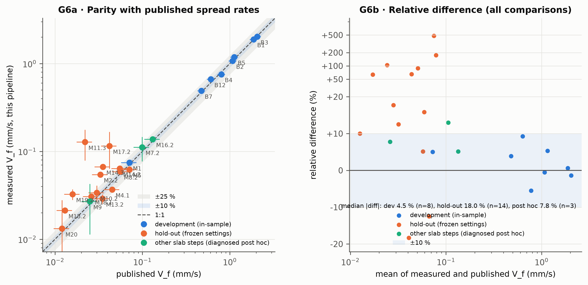

**G6 — validation against published spread rates.** Left: measured steady V_f (geometric ruler calibration) against published values (SDSU side view for B films, NASA TM-20210011385 Table 5.1 for M slabs); error bars are ±2σ on both axes (measured σ includes the 2 % scale uncertainty). Blue = development tests, used to choose the segmentation and regime settings (in-sample); orange = hold-out slab tests processed only after all settings were frozen; green = other slab steps examined while diagnosing regime selection (not independent). Hollow markers are comparisons rejected by the physics review, which was done with published values visible. Right: relative difference for every comparison; the legend gives the median absolute difference per set. The spatial calibration uses no published value.

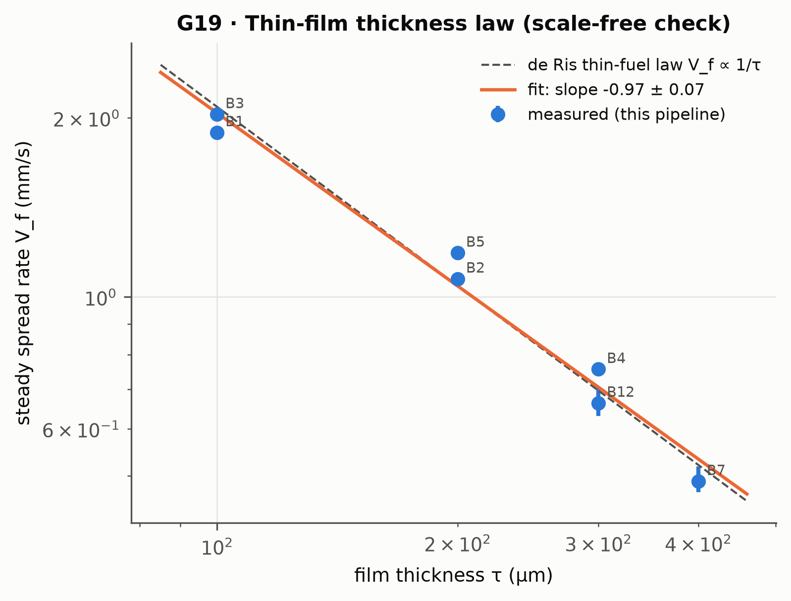

**G19 — V_f vs. film thickness for PMMA films in opposed flow (O₂ > 19.5 %).** Log-log axes. The fitted slope (-0.97 ± 0.07, R² = 0.98, n = 7) does not depend on the spatial calibration, so it validates the edge tracking itself. The de Ris thin-fuel theory predicts −1; the published SDSU values give -0.99 ± 0.09. Scatter at equal thickness reflects different flow velocities and O₂.

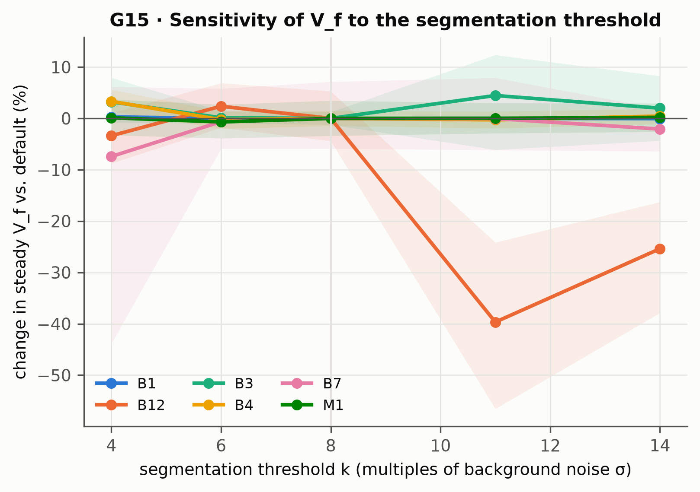

**G15.** Relative change of the steady spread rate when the noise-relative threshold k varies from 4σ to 14σ around the default (8σ, vertical line; high threshold = 2k, floors scaled alike); shaded bands are the 95 % CIs. Robust (< 5 % change): B1, B3, B4, M1. Threshold-dependent: B12 (up to 40 %), B7 (up to 7 %) — these faint flames carry a systematic uncertainty larger than their statistical CI. Tests whose default run gives no steady rate are omitted.

## 5. Physics quality control
Every test was reviewed for physical plausibility (reports/physics_review.md); verdicts are versioned in configs/qc.yaml and used to select tests for ensemble figures and trends. Counts: excluded 34, flagged 10, order_of_magnitude 1, trusted 15, trusted_null 9, trusted_steps_only 1, unreviewed 13. Excluded tests include missed dim burns, igniter-flash or ignition-growth regimes, rods where the video measures flame-length settling rather than spread, and insufficient footage. The review saw published values, so it is not an independent test.

## 6. Example tests
### B1
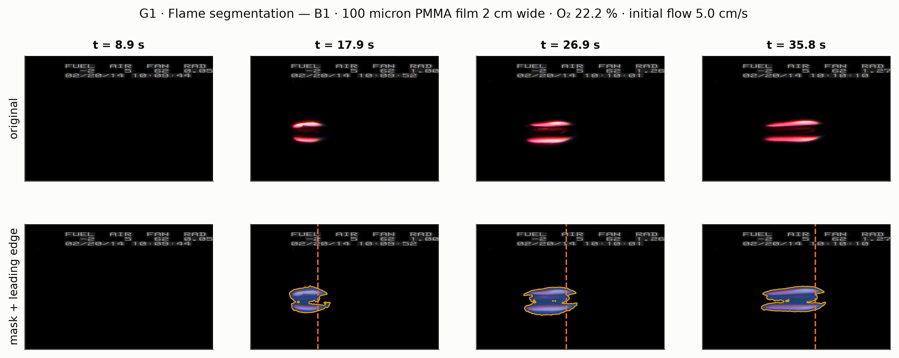

**G1 — B1.** Top row: original frames (720×480, OSD telemetry visible). Bottom row: flame mask (translucent blue), contour (yellow) and leading edge (dashed orange line). A good segmentation covers the faint flame base and excludes the OSD, reflections and the igniter; the leading edge must sit at the advancing tip.

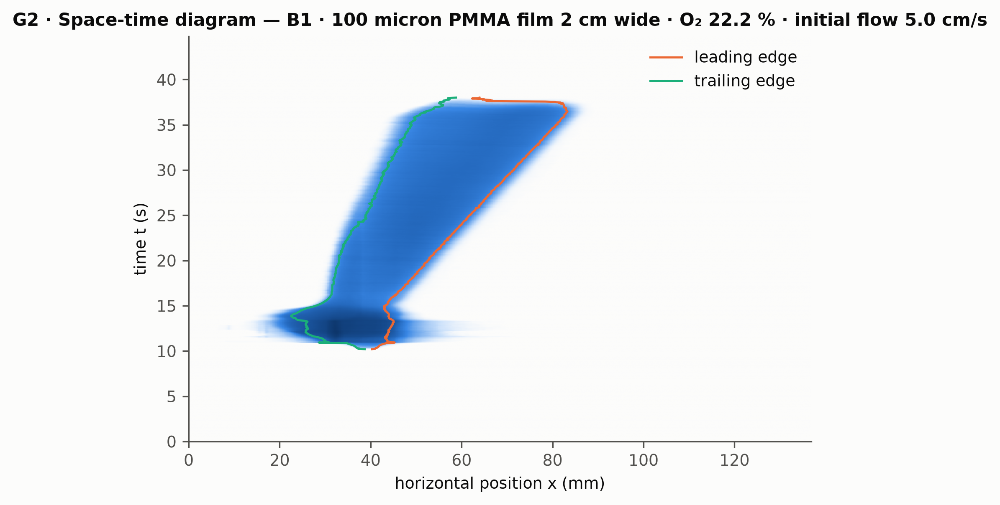

**G2 — kymograph of B1.** Each row is the horizontal flame-intensity profile at one instant (darker = brighter, log scale). A slanted band means spread: since time runs vertically, the visual slope is 1/V_f (flatter = faster). Straight band = constant speed; curvature = acceleration or deceleration; fading = approach to extinction; horizontal stripes = exposure changes or bad frames.

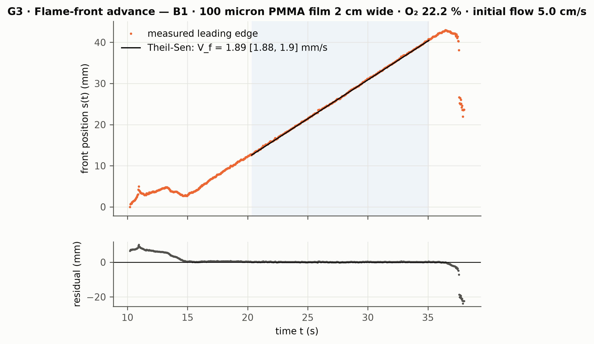

**G3 — B1.** Dots: leading-edge position projected on the spread direction (origin at first detection). Line: robust Theil-Sen fit over the shaded steady window; its slope is the spread rate V_f with a 95 % CI. Bottom panel: residuals, which should look like structureless noise. Systematic curvature means the spread is not steady (growth or approach to extinction) and a linear model is not enough.

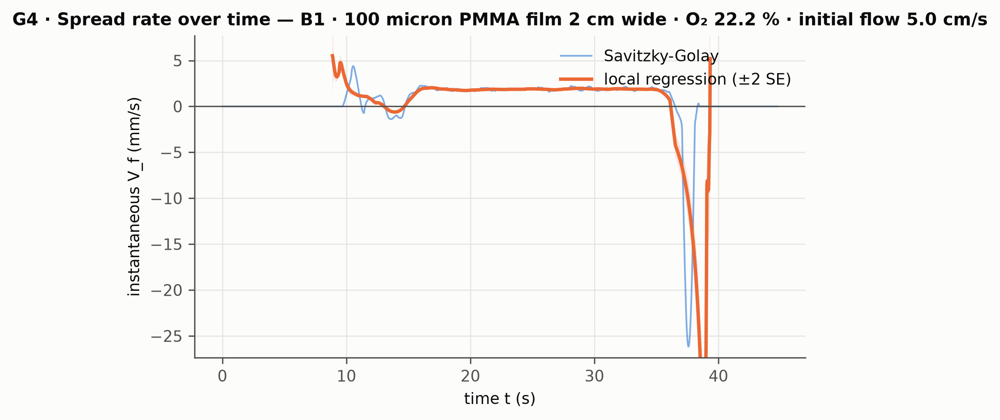

**G4 — B1.** Instantaneous front speed from a Savitzky-Golay derivative (blue) and from a sliding-window regression with a ±2 standard-error band (orange). A plateau marks the steady regime (it defines the fit window of G3); drops at the end anticipate extinction; jumps that coincide with FAN changes reflect the flow steps imposed by the crew.

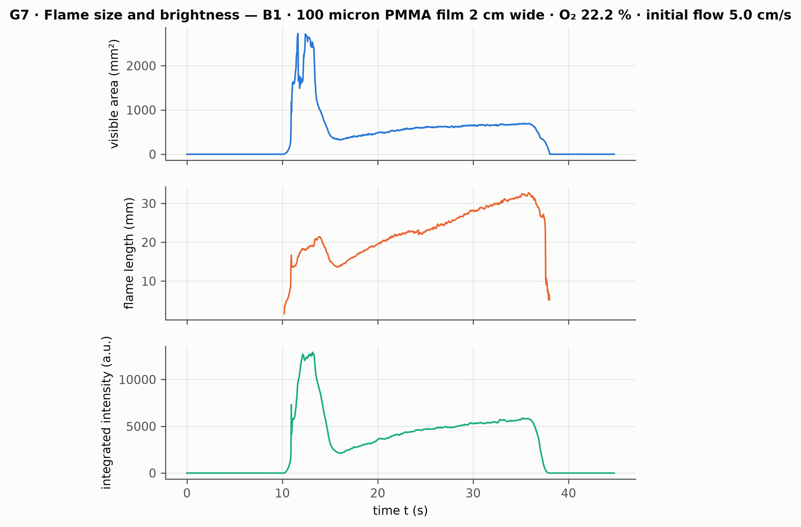

**G7 — B1.** Stacked panels (shared time axis, independent scales, no dual axis): luminous area, length along the spread direction and integrated intensity (≈ visible radiated energy). Growth to a plateau = flame reaching a steady size; decay = approach to extinction. Compare with the RAD radiometer trace (OSD, G18) as an independent check.

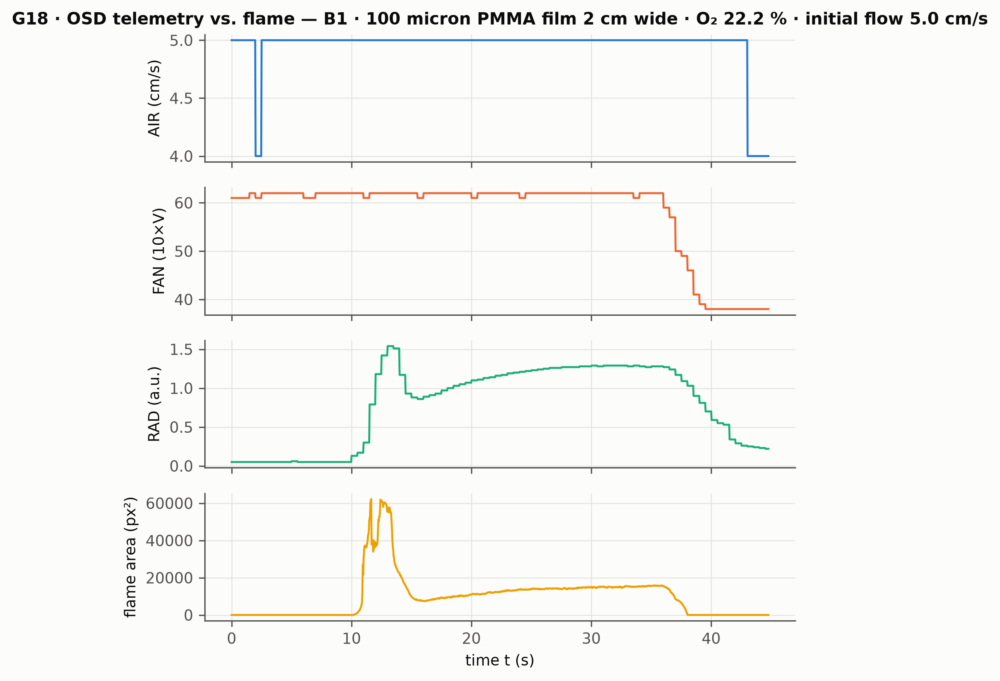

**G18 — B1.** Telemetry read by OCR from the video (AIR = air velocity, lagging the fan by ≈15–25 s; FAN = 10× fan voltage; RAD = uncalibrated radiometer) aligned with the luminous area measured by computer vision. RAD and area should co-vary (independent cross-check). FAN steps are the crew's flow manoeuvres and explain changes in V_f.

### B4
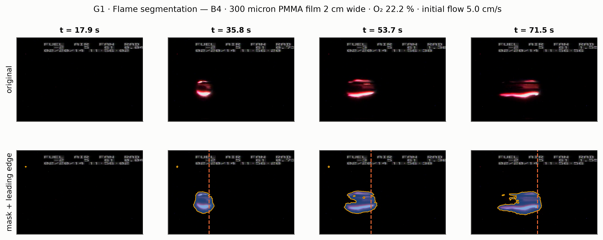

**G1 — B4.** Top row: original frames (720×480, OSD telemetry visible). Bottom row: flame mask (translucent blue), contour (yellow) and leading edge (dashed orange line). A good segmentation covers the faint flame base and excludes the OSD, reflections and the igniter; the leading edge must sit at the advancing tip.

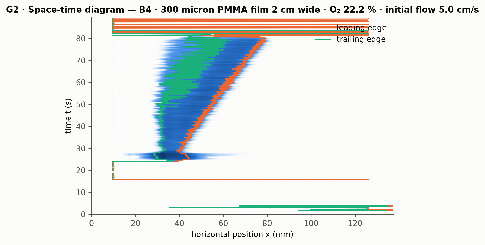

**G2 — kymograph of B4.** Each row is the horizontal flame-intensity profile at one instant (darker = brighter, log scale). A slanted band means spread: since time runs vertically, the visual slope is 1/V_f (flatter = faster). Straight band = constant speed; curvature = acceleration or deceleration; fading = approach to extinction; horizontal stripes = exposure changes or bad frames.

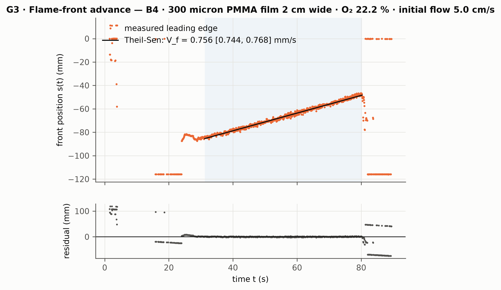

**G3 — B4.** Dots: leading-edge position projected on the spread direction (origin at first detection). Line: robust Theil-Sen fit over the shaded steady window; its slope is the spread rate V_f with a 95 % CI. Bottom panel: residuals, which should look like structureless noise. Systematic curvature means the spread is not steady (growth or approach to extinction) and a linear model is not enough.

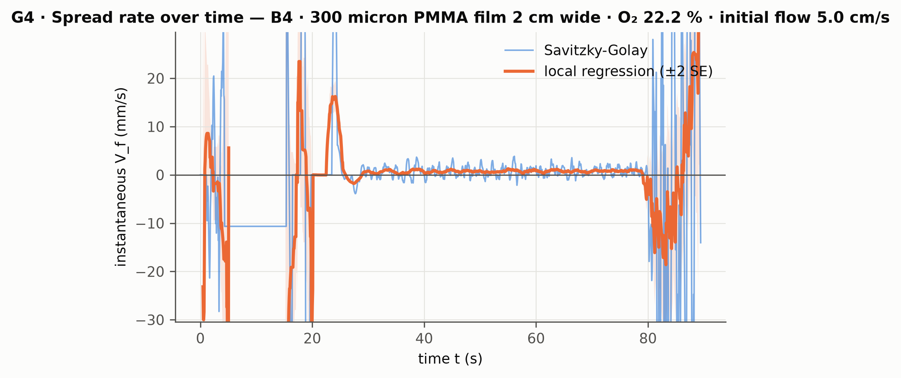

**G4 — B4.** Instantaneous front speed from a Savitzky-Golay derivative (blue) and from a sliding-window regression with a ±2 standard-error band (orange). A plateau marks the steady regime (it defines the fit window of G3); drops at the end anticipate extinction; jumps that coincide with FAN changes reflect the flow steps imposed by the crew.

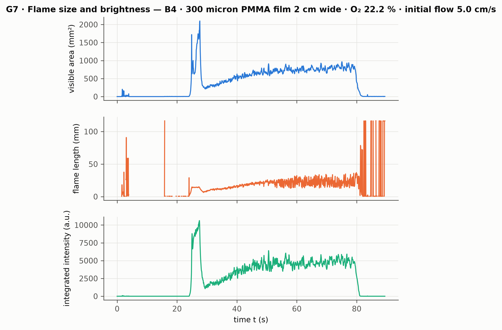

**G7 — B4.** Stacked panels (shared time axis, independent scales, no dual axis): luminous area, length along the spread direction and integrated intensity (≈ visible radiated energy). Growth to a plateau = flame reaching a steady size; decay = approach to extinction. Compare with the RAD radiometer trace (OSD, G18) as an independent check.

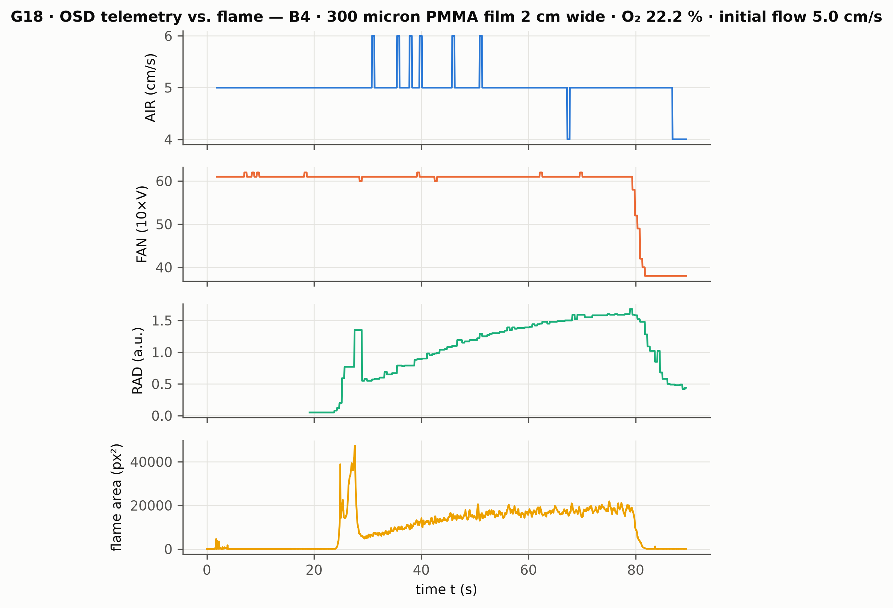

**G18 — B4.** Telemetry read by OCR from the video (AIR = air velocity, lagging the fan by ≈15–25 s; FAN = 10× fan voltage; RAD = uncalibrated radiometer) aligned with the luminous area measured by computer vision. RAD and area should co-vary (independent cross-check). FAN steps are the crew's flow manoeuvres and explain changes in V_f.

### M1
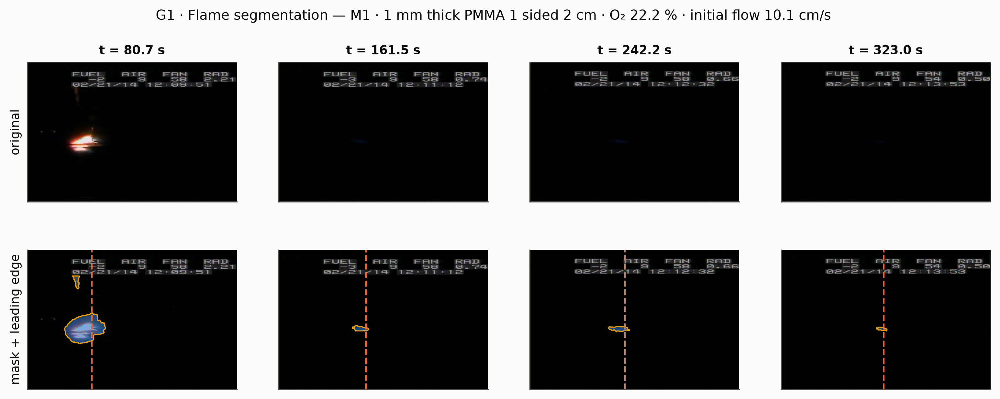

**G1 — M1.** Top row: original frames (720×480, OSD telemetry visible). Bottom row: flame mask (translucent blue), contour (yellow) and leading edge (dashed orange line). A good segmentation covers the faint flame base and excludes the OSD, reflections and the igniter; the leading edge must sit at the advancing tip.

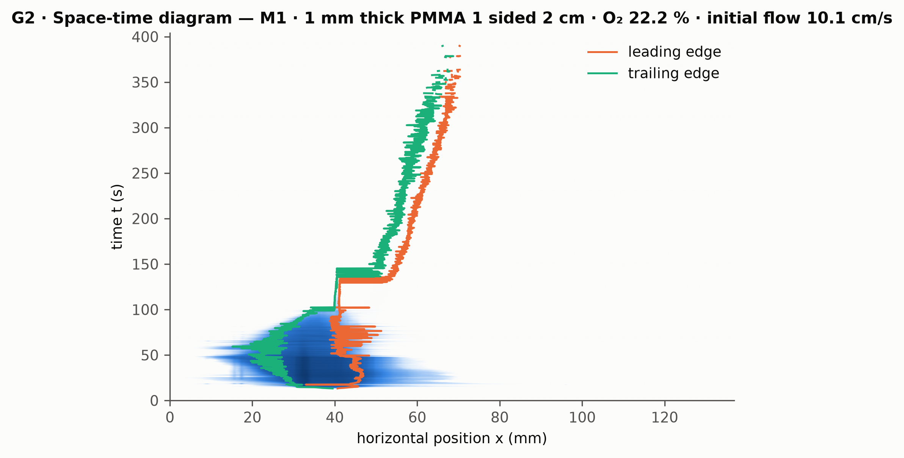

**G2 — kymograph of M1.** Each row is the horizontal flame-intensity profile at one instant (darker = brighter, log scale). A slanted band means spread: since time runs vertically, the visual slope is 1/V_f (flatter = faster). Straight band = constant speed; curvature = acceleration or deceleration; fading = approach to extinction; horizontal stripes = exposure changes or bad frames.

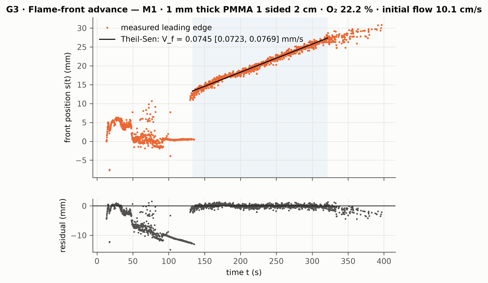

**G3 — M1.** Dots: leading-edge position projected on the spread direction (origin at first detection). Line: robust Theil-Sen fit over the shaded steady window; its slope is the spread rate V_f with a 95 % CI. Bottom panel: residuals, which should look like structureless noise. Systematic curvature means the spread is not steady (growth or approach to extinction) and a linear model is not enough.

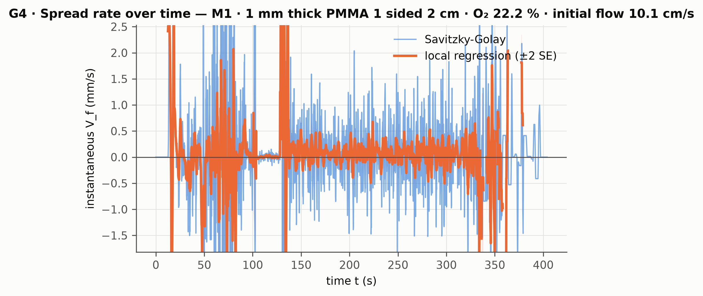

**G4 — M1.** Instantaneous front speed from a Savitzky-Golay derivative (blue) and from a sliding-window regression with a ±2 standard-error band (orange). A plateau marks the steady regime (it defines the fit window of G3); drops at the end anticipate extinction; jumps that coincide with FAN changes reflect the flow steps imposed by the crew.

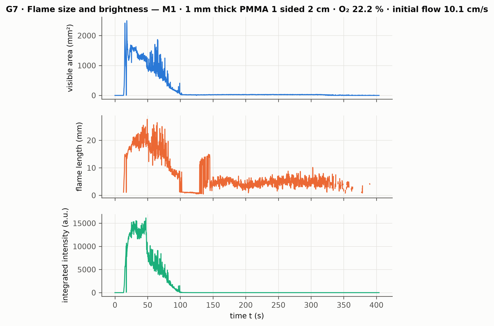

**G7 — M1.** Stacked panels (shared time axis, independent scales, no dual axis): luminous area, length along the spread direction and integrated intensity (≈ visible radiated energy). Growth to a plateau = flame reaching a steady size; decay = approach to extinction. Compare with the RAD radiometer trace (OSD, G18) as an independent check.

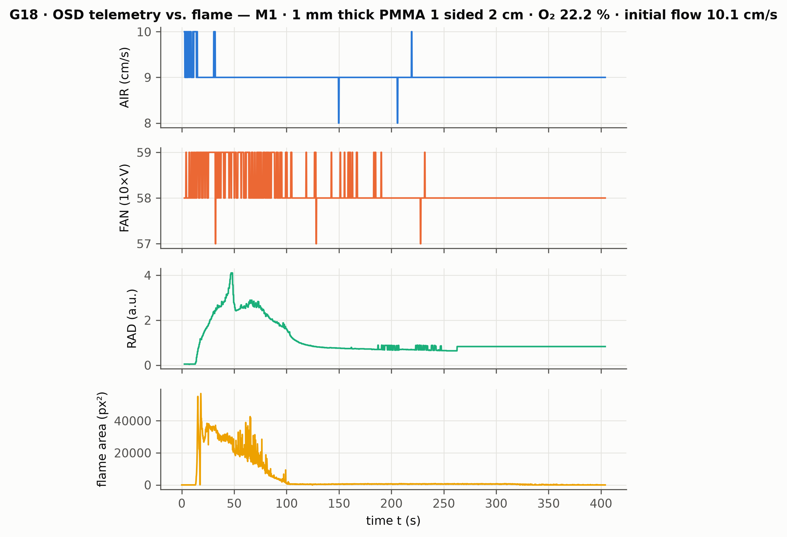

**G18 — M1.** Telemetry read by OCR from the video (AIR = air velocity, lagging the fan by ≈15–25 s; FAN = 10× fan voltage; RAD = uncalibrated radiometer) aligned with the luminous area measured by computer vision. RAD and area should co-vary (independent cross-check). FAN steps are the crew's flow manoeuvres and explain changes in V_f.

## 7. Ensemble results
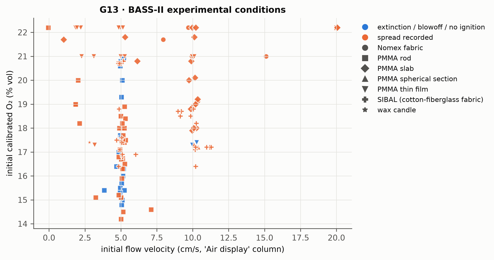

**G13.** Each point is one test (small horizontal jitter to avoid overlap). Colour = outcome noted by the crew; shape = material class. Shows the experimental coverage: where there is data to validate against and where a model would extrapolate. Extinctions cluster at low flow / low O₂, approaching the microgravity flammability limit. Note: many tests step the flow during the burn; only the initial value is shown, and a few O-test rows are known parser outliers (see docs/ROADMAP.md).

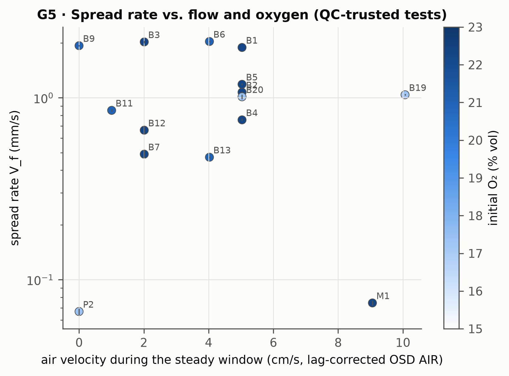

**G5.** Steady spread rate (95 % CI, log scale) of the QC-trusted tests (configs/qc.yaml) against the air velocity measured during each steady window; colour = MCA-calibrated initial O₂. V_f is expected to increase with O₂; against flow, microgravity can show a maximum at low flow (radiative → thermal → kinetic regimes). Compare with published values (knowledge/literature/publications.md §2).

## 8. Forecasting
Leading-edge position of the QC-trusted tests, steady windows: mean MASE by horizon (lower is better; < 1 beats the in-sample naive one-step forecast) and mean 90 % interval coverage. The steady window is chosen with hindsight and the MASE scale uses the whole series, so these numbers describe forecasting *within* a steady-spread regime.

| Model | h=1 s | h=5 s | h=10 s | coverage |
|---|---|---|---|---|
| drift | 0.73 | 1.30 | 1.89 | 0.75 |
| holt_damped | 0.84 | 1.72 | 3.58 | 0.57 |
| kalman_conformal | 0.78 | 1.40 | 2.21 | 0.91 |
| kalman_cv | 0.99 | 2.51 | 4.42 | 0.97 |
| kalman_mle | 0.74 | 1.08 | 1.61 | 0.93 |
| persistence | 1.31 | 4.26 | 8.32 | 0.69 |
| physics_linear | 0.85 | 0.93 | 1.12 | 0.80 |

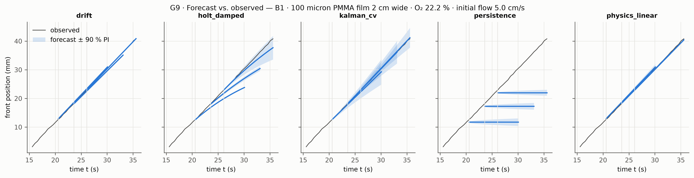

**G9 — B1.** Grey: observed series. Blue: forecasts from several origins (vertical lines) with 90 % prediction intervals. An honest model contains the observation ~9 times out of 10 and its bands widen with the horizon. A median that flattens against a linear advance indicates a model that is mis-specified for steady spread.

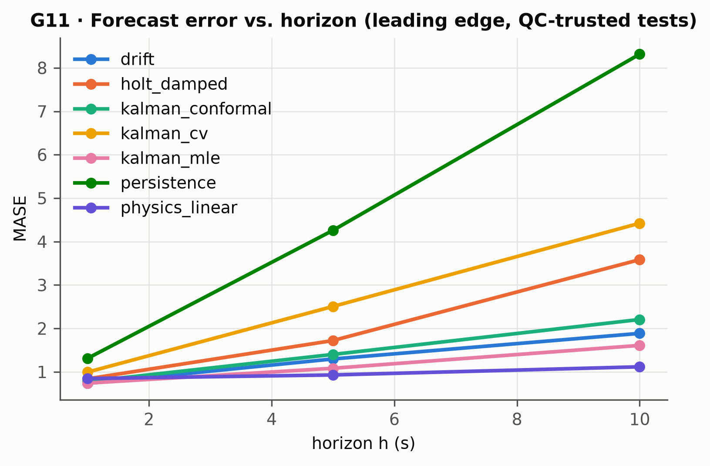

**G11.** Mean MASE per model and horizon (rolling-origin evaluation, no temporal leakage). Lower is better; MASE < 1 beats the naive one-step forecast. Some models usually win at short horizons and lose at long ones: choose according to the operational horizon.

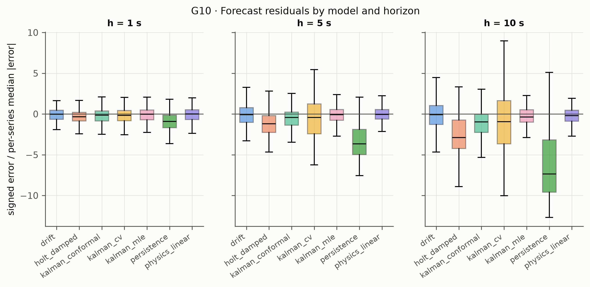

**G10.** Distribution of signed forecast errors (normalised per test and target so different units and scales are comparable) for each model and horizon, pooled over all tests and rolling origins. A box centred on zero = unbiased; a narrow box = precise. Boxes drifting below zero at long horizons reveal models that under-predict steady flame advance (e.g. persistence, damped trend).

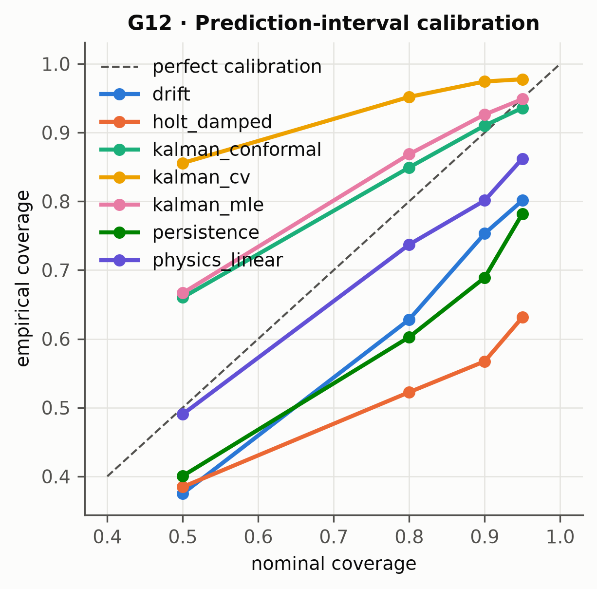

**G12.** Empirical vs. nominal coverage of the prediction intervals (Gaussian assumption). Points below the diagonal = intervals too narrow (over-confidence); above it = too wide.

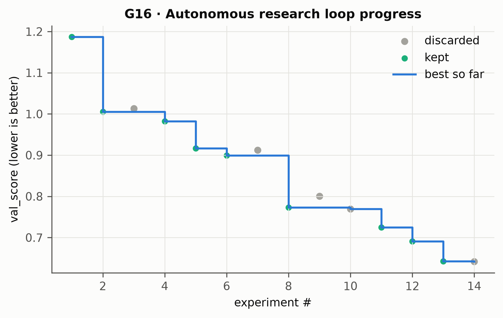

**G16.** Every evaluation of research/experiment.py by the fixed harness (val_score combines segmentation, spread-rate accuracy and forecast skill, each normalised to the v0 baseline = 1). Green points were kept, grey ones reverted. The blue staircase is the best score so far; a long flat tail means the loop has converged on the current development set.

Autonomous research loop: 14 evaluations; best val_score **0.643** versus 1.187 for the v0 baseline (lower is better). Best change: forecast: per-horizon inverse-MSE (Bates-Granger) combination of Kalman, 5 s local linear and persistence (no-trend member for plateaus). The loop's spread-rate component uses the development tests, so loop gains on R are in-sample too.

## 9. Limitations
- The ruler graduation (1 cm major marks) is inferred from duct geometry; NASA documents do not state it.
- Development accuracy is in-sample (see §4); the hold-out slab results are the out-of-sample evidence.
- Thick slabs: later flow steps are over-estimated (hold-out median error 64.5 %) because the per-step window starts before the spread re-equilibrates after the flow change; a transient-aware window is the next fix.
- Faint flames can depend on the segmentation threshold (G15 lists which tests are robust and which are not); this systematic uncertainty is not included in the per-test CIs.
- Segmentation is scored on synthetic flames until a hand-labelled gold set exists.
- OSD OCR occasionally misses the last RAD digit (left as NaN, never guessed).

## 10. Reproduce (from investigations/BASS-II, Windows venv)
```bash
.venv/Scripts/python scripts/download_study.py && .venv/Scripts/python scripts/download_study.py holdout_tests.yaml
.venv/Scripts/python scripts/calibrate_study.py
.venv/Scripts/python scripts/analyze_study.py --workers 5      # videos -> frames, regimes, figures
.venv/Scripts/python scripts/refit_study.py                    # regimes/backtests/figures from saved frames
.venv/Scripts/python scripts/compare_segmenters.py             # development-only segmenter comparison
.venv/Scripts/python scripts/sensitivity.py
.venv/Scripts/bass2 aggregate && .venv/Scripts/python -m bass2.report && .venv/Scripts/python scripts/build_site.py
```
