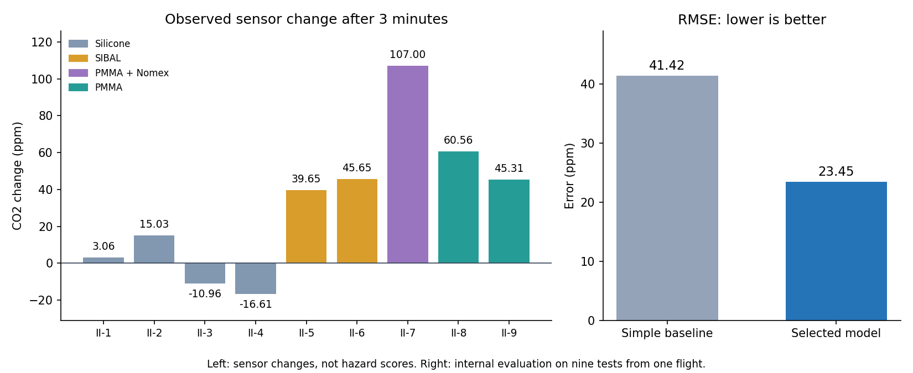
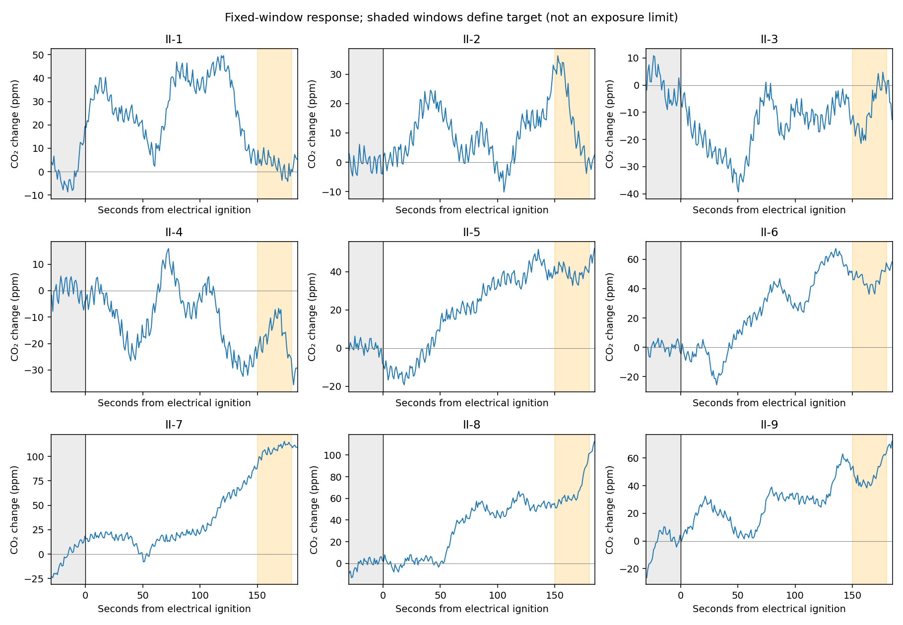
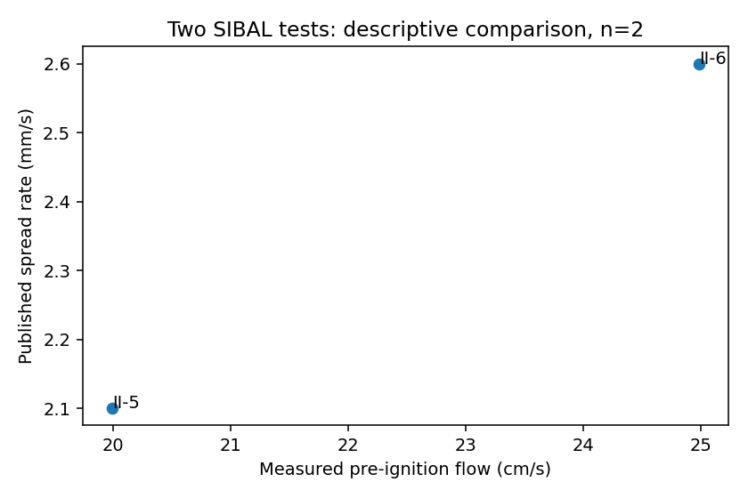

# Saffire-II: fire-test evidence and a predictive pilot

This project organizes NASA Saffire-II measurements, compares material behavior, and builds a small model of the **local CO2 sensor change three minutes after ignition**. The local archive contains **nine tests from one flight**, represented by 218 physical files. The model is an internally evaluated pilot; transfer to other flights, atmospheres or gravity levels has not been validated.

## Where to start

| File | What it explains or contains |
|---|---|
| [SAFFIRE_EXPLICADO.md](SAFFIRE_EXPLICADO.md) | **Start here:** a plain-English explanation of what was measured, what was calculated, the results and what they mean. |
| [analysis-saffire-summary.json](analysis-saffire-summary.json) | **Dashboard input:** English text, structured test results, insights, model errors, limitations, source citation and figure paths. |
| [SAFFIRE_ANALYSIS_REPORT_EN.md](SAFFIRE_ANALYSIS_REPORT_EN.md) | The longer English report: methods, all 35 metric definitions, all 15 model attempts, interpretation and data-quality issues. |
| [analysis-saffire.json](analysis-saffire.json) | Full scientific export with per-value provenance, methods, assumptions, detailed predictions and rankings. Some original explanatory notes are in Spanish. |
| [DATA_PLAN.md](DATA_PLAN.md) | The English data plan: extraction decisions, target selection and habitat-ranking assumptions. |
| [data/processed/metrics.csv](data/processed/metrics.csv) | Values, units, source files, methods and reasons for missing results. |

## Data source and attribution

Urban DL, Ruff G. "Spacecraft Fire Experiment-II(SAFFIRE-II)", NASA PSI Data Repository, Version 5, [http://doi.org/10.60555/2chp-m469](http://doi.org/10.60555/2chp-m469).

NASA supplied the measurements, camera images and published material outcomes. The extraction choices, derived CO2 response, model search, relevance rankings and interpretations were produced in this project.

The local metadata identifies the investigation as **PSI-99**. Only Saffire-II has local raw test data, even though contextual documents discuss other Saffire missions. See the [inventory](data/inventory/INVENTORY.md) for scope and ambiguities.

## Dashboard JSON: format and use

Load **[analysis-saffire-summary.json](analysis-saffire-summary.json)** for the interface. It declares `schema_version: "1.0.0"` and `language: "en"`. Both property names and explanatory text are in English. This replaces the earlier unversioned Spanish summary; use the English keys below.

| Field | Dashboard use |
|---|---|
| `title`, `summary`, `scope` | Project header, experiment scope and record counts. |
| `reading_guide` | Explain measured, published, calculated and predicted results. |
| `measurements[]` | Cards with a measurement label, result, origin, interpretation and detail reference. |
| `co2_calculation` | Explain the target with a real before/after example. |
| `test_results[]` | Tables, filters and charts using numeric test conditions and outcomes. |
| `insights[]` | Findings with evidence, meaning, usefulness and `low`, `medium` or `high` confidence. |
| `predictive_model` | Model purpose, evaluation, baseline comparison, error metrics, held-out predictions, worst case and limitations. |
| `habitat_relevance` | Explain relevance to habitat scenarios and the limits of transfer. |
| `unavailable_results[]` | Display missing or unvalidated results with `value: null`, status and reason. |
| `source` | Dataset citation, DOI link and attribution. |
| `charts[]`, `files` | Figure metadata and paths to supporting artifacts. |

Each `test_results` entry has a stable `test_id`, `material_code`, `outcome_code`, readable labels and numeric fields. Material codes are `Silicone`, `SIBAL`, `PMMA_Nomex` and `PMMA`. Units are explicit in keys such as `airflow_cm_s`, `pressure_kpa`, `oxygen_pct`, `co2_change_180s_ppm`, `plume_peak_180s_c`, `radiation_peak_excess_180s_kw_m2`, `spread_rate_published_mm_s` and `burn_duration_published_s`.

Integration rules:

- Render `null` as unavailable or not applicable; do not turn it into zero. Seven tests have no numeric published spread rate.
- Use `test_results[].co2_change_180s_ppm` for the observed derived response. It is distinct from a model prediction and from total emitted gas or hazard.
- `predictive_model.errors_ppm` contains `mean_absolute_error`, `rmse` and `maximum_absolute_error`; each has `baseline`, `best_model` and `meaning`. Lower error is better. `rmse_reduction_pct` is a relative error reduction, not an accuracy or safety percentage.
- `predictive_model.cv_predictions[]` provides the observed, predicted and signed-error values for an observed-versus-predicted chart. These are held-out predictions, not predictions for another mission.
- `detail_ref` and `evidence_refs` point to supporting files or locations in the detailed JSON, for example `analysis-saffire.json#/tests/4`.
- File and image paths are relative to this directory. Copy the JSON and required images into the dashboard's served assets, preserving those paths or resolving them against its configured asset base.

For example, when the JSON is served at the site root:

```javascript
const response = await fetch("/analysis-saffire-summary.json");
if (!response.ok) throw new Error("Could not load Saffire results");
const saffire = await response.json();
if (saffire.schema_version !== "1.0.0") throw new Error("Unsupported Saffire summary format");
const co2Series = saffire.test_results.map(test => ({
  testId: test.test_id,
  material: test.material,
  changePpm: test.co2_change_180s_ppm,
}));
```

The summary has rounded display values. Use [the detailed export](analysis-saffire.json) and [processed CSVs](data/processed/) for full numerical precision and per-value provenance. Sensor variability is not an absolute calibration accuracy. The calculated ignitor energy has an unresolved scaling discrepancy and is explicitly marked as requiring validation; it was not used to train the model.

## Figures and how to read them

### 1. Observed CO2 response and model error



The **left panel** shows each test's CO2 change after three minutes relative to its own baseline. Colors group materials. Negative bars are small decreases in sensor readings, potentially reflecting variation or mixing. A larger bar does not establish a more hazardous material.

The **right panel** compares RMSE: **41.42 ppm** for the simple training-mean baseline and **23.45 ppm** for the selected model. This is internal cross-validation across nine tests in one flight, not validation in another mission. Mean absolute error is a different metric: **17.83 ppm** for the selected model.

### 2. The windows used to calculate CO2 change



Each panel shows one test's baseline-subtracted CO2 over time. The **gray region** covers the 30 seconds before the electrical ignition marker. The **orange region** covers 150-180 seconds. The target subtracts the typical gray-window reading from the typical orange-window reading. These are calculation windows, not exposure thresholds.

### 3. The two published SIBAL spread rates



These are **published rates**, plotted against measured pre-ignition airflow: **2.1 mm/s** near **20 cm/s** and **2.6 mm/s** near **25 cm/s**. The comparison has only two observations; it is not a fitted universal relationship and does not establish causality.

Additional figures are linked from `charts` in the dashboard JSON:

- [Temperature quality control](data/processed/figures/temperature_quality_control.png) compares sampled plume thermocouples with inlet temperature. Uneven sensor coverage means these are local readings, not maximum flame or spatially averaged cabin temperatures.
- [Camera contact sheet](data/processed/figures/image_contact_sheet.jpg) samples three frames per test near 30, 90 and 150 seconds. It supports visual inspection; no independently calibrated front trajectory was extracted.

## Reproduce the outputs

Requirements: Python 3.10+, NumPy, Matplotlib, Pillow, pytest and `pdftotext` from Poppler. The existing exports can be read without downloading the raw archive.

Regenerate only the English dashboard summary, plain-language report and overview figure from the detailed export:

```bash
.venv/bin/python analysis/build_summary.py
```

For a full extraction, obtain the cited NASA dataset and set `SAFFIRE_RAW_DATA`:

```bash
python3 -m venv .venv
.venv/bin/python -m pip install -e '.[extraction,dev]'
export SAFFIRE_RAW_DATA=/path/to/raw_data
.venv/bin/python extraction/run_all.py
.venv/bin/python prepare.py --check
.venv/bin/python analysis/build_analysis_json.py
.venv/bin/python -m pytest -q
```

`analysis/build_analysis_json.py` also regenerates `analysis-saffire.md`, the English dashboard summary, the plain-language explanation and the overview figure. Preserve `runs/autoresearch/saffire-run-01/` to retain the original baseline, selected model, candidate history and held-out predictions. The recorded evaluation evidence is necessary for reproducing the reported comparison.

## Research implementation and evidence

- `extraction/` streams spreadsheet rows, inventories archives and generates traced metrics and control figures.
- `data/inventory/` contains the inventory, extracted documentation and original file hashes.
- `data/processed/` contains cleaned CSVs, figures and validation details.
- `prepare.py` fixes the allowed model inputs and evaluation. `train.py` was the only editable candidate during the search.
- `analysis/build_summary.py` generates the English dashboard export and plain-language explanation.
- `runs/` contains experiment JSONs, logs, the TSV ledger and verification evidence.
- `upstream_reference/` preserves the original AutoResearch LLM training files.

All 15 model attempts are complete. The selected experimental commit is `2af682a96609f938a023eb5bf94d62441d4e0d4d`; its difference from `baseline-v1` contains only `train.py`. Documentation and publication changes follow that experiment and do not rewrite its recorded evaluations. A new model study needs a separately versioned protocol and baseline.

```bash
.venv/bin/python scripts/verify_reproducibility.py
.venv/bin/python -m pytest -q
git diff --name-only baseline-v1..2af682a96609f938a023eb5bf94d62441d4e0d4d
```

The original scientific export and processed files were regenerated twice with identical scientific results, apart from the full export's `generated_at` field. Raw-file SHA-256 hashes were checked against the initial manifest. Reproducibility does not resolve missing sensor calibration or provide external model validation.

## What belongs in Git

Commit the detailed and summary JSON files, Markdown reports, source code, processed CSVs, figures, inventory, hashes and `runs/` evidence. The `.gitignore` intentionally allows these results.

Exclude `raw_data/` because it occupies about **33.81 GB**, and exclude local environments, caches, build files and secrets. Regeneration of the raw extraction requires a separate dataset download; dashboard consumption needs only the exported JSON and the assets it displays.

Dataset source: Urban DL, Ruff G. "Spacecraft Fire Experiment-II(SAFFIRE-II)", NASA PSI Data Repository, Version 5, [http://doi.org/10.60555/2chp-m469](http://doi.org/10.60555/2chp-m469).
