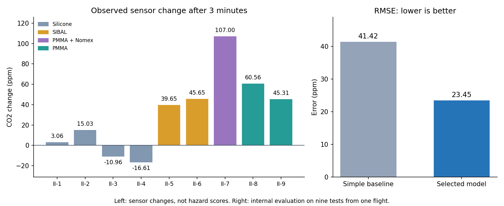

# Saffire-II explained in plain English

**Nine specimens were compared. All four silicone specimens showed no sustained flame spread. Flames spread over the full length of both SIBAL fabrics. The PMMA slabs sustained flames near the leading edge for several minutes.**

Our work organized NASA's evidence, calculated comparable measurements and built a first predictive model. **The model estimates one thing: how much CO2 changes at one sensor three minutes after the electrical ignition marker.**

## 1. What data we had

NASA ignited material specimens inside an uncrewed Cygnus spacecraft in microgravity. Flame spread means the flame advances into new areas of the material.

There were 218 physical files, but only **nine Saffire-II tests from one flight**. Each specimen was approximately 29 by 5 cm. Duplicate files and many camera frames are not additional experiments.

Sensors recorded CO2, oxygen, airflow, pressure, temperatures, radiation and smoke signals. Documentation also reported how the materials burned. The dataset is identified as **PSI-99**.

The results have three different origins:

- **Published observation:** NASA had already reported, for example, that flame spread over the SIBAL fabric.
- **Calculation in this study:** sensor readings were processed to measure the CO2 change after three minutes.
- **Model prediction:** an estimate of that change, compared with the observation to measure its error.

## 2. What the CO2 number means

CO2 is carbon dioxide. Its concentration is expressed in **ppm**, or parts per million. Each test's pre-ignition reading is subtracted from its reading around three minutes later.

A real example from SIBAL test II-5:

| Time | CO2 sensor reading |
|---|---:|
| Before ignition | 3350 ppm |
| Around three minutes | 3390 ppm |
| Change used for comparison | **+40 ppm** |

Typical readings are medians over 30-second windows, reducing the influence of isolated readings. Every test uses the same comparison period. **This is a local sensor response; it is not total gas emitted or a direct measure of danger to people.**

## 3. What happened in each test

The CO2 column is our calculation. The behavior description comes from the supplied documentation. A negative CO2 change means the reading fell slightly below its initial level, potentially because of variation or air mixing; it does not demonstrate CO2 consumption by the fire.

| Test | Material | CO2 change after 3 min | Documented behavior |
|---|---|---:|---|
| II-1 | Silicone | +3.06 ppm | The flame did not spread in a sustained way. |
| II-2 | Silicone | +15.03 ppm | The flame did not spread in a sustained way. |
| II-3 | Silicone | -10.96 ppm | The flame did not spread in a sustained way. |
| II-4 | Silicone | -16.61 ppm | The flame did not spread in a sustained way. |
| II-5 | SIBAL: cotton and fiberglass fabric | +39.65 ppm | The flame spread along the full 29 cm fabric sample. |
| II-6 | SIBAL: cotton and fiberglass fabric | +45.65 ppm | The flame spread along the full 29 cm fabric sample. |
| II-7 | PMMA followed by Nomex | +107.00 ppm | The PMMA section was consumed; the Nomex did not ignite. |
| II-8 | PMMA: acrylic plastic | +60.56 ppm | The flame stayed near the leading edge while the material continued burning slowly. |
| II-9 | PMMA: acrylic plastic | +45.31 ppm | The flame stayed near the leading edge while the material continued burning slowly. |

**The PMMA-Nomex specimen had the largest early CO2 change, even though its Nomex did not ignite.** A larger CO2 change alone cannot rank materials by overall fire hazard.

## 4. What we learned and why it matters

**S1. Silicone did not sustain flame spread in these tests.** This occurred in all four silicone specimens. The observed behavior was limited under this combination of airflow, oxygen, pressure and specimen geometry. Provides evidence for material comparisons; it does not certify all silicone configurations as safe. Confidence: medium.

**S2. Flames spread over both SIBAL fabrics.** Published rates were 2.1 mm/s at roughly 20 cm/s airflow and 2.6 mm/s at roughly 25 cm/s. The second rate was 23.8% higher. This is a comparison of two tests, not a universal airflow law. Identifies a relationship worth testing with more ventilation and propagation experiments. Confidence: low.

**S3. A flame can advance slowly while burning persists for minutes.** The PMMA slabs have published burn durations of 10 and 15 minutes, with flames near the leading edge. Limited advance and extinguishment are different outcomes. Fire-safety analysis must also consider how long burning persists. Confidence: low.

**S4. The composite's PMMA burned, but Nomex did not ignite.** Only one specimen used this combination. The fire did not transfer from the PMMA section to the Nomex section in that test. Provides a material comparison case that needs replication under other conditions. Confidence: low.

**S5. Each test needs its own CO2 baseline.** Pre-test readings ranged from approximately 3307 to 4334 ppm. The tests started at different CO2 levels, so each response subtracts its own initial reading. Avoids attributing CO2 already present to the current test. Confidence: medium.

**S6. The model improved one specific prediction in a small pilot.** Its mean absolute held-out error was 17.83 ppm. It estimates the three-minute sensor change within this pilot; another flight is needed for external validation. Provides a first tool for comparing predicted and observed responses. Confidence: low.

**S7. The data are closer to the assumed ISS and Gateway scenarios.** The tests used near-terrestrial pressure, airlike oxygen and microgravity. They more closely match those reference scenarios used in the relevance comparison. Helps prioritize which evidence to consult for a given environment. Confidence: medium.

**S8. Transfer to lunar, Mars and rover environments remains unvalidated.** The local archive has no enriched-oxygen, low-pressure or lunar/Martian partial-gravity tests. Comparisons with those habitats are indicative and use analyst design assumptions. Identifies additional experiments needed before extrapolating. Confidence: medium.

**S9. Smoke signals alone cannot establish alarm timing.** Alarm events, thresholds and verified clock synchronization are missing. A reliable detection delay is unavailable for each test. Identifies the information needed to evaluate detection equipment. Confidence: low.

## 5. What the model did and what its error means

To evaluate a model, one test was held out, the other eight were used for training, and the held-out response was predicted. This was repeated for all nine tests. Fifteen model candidates used the same procedure.

The simple baseline always predicted the training-data mean. The selected model uses one group for silicone and another for the other materials, with an airflow adjustment.

| Error measure | Simple baseline | Selected model |
|---|---:|---:|
| Mean absolute error | 34.45 ppm | **17.83 ppm** |
| RMSE: gives larger mistakes more weight | 41.42 ppm | **23.45 ppm** |
| Largest absolute error | 84.29 ppm | 56.36 ppm |

The easiest interpretation is: **the selected model missed the observed change by about 18 ppm on average in this nine-test evaluation**. Errors vary: for II-7, it predicted about 51 ppm while the observed change was 107 ppm, a miss of about 56 ppm.

RMSE decreased by 43.4% relative to the baseline. **This is a reduction in an error measure, not a 43.4% accuracy rate or a safety percentage.**

This remains a pilot: nine tests share one flight, and the best model was selected using the same evaluation repeatedly. Only one test used the substantially higher flow, and only one used PMMA-Nomex. New experiments are needed for external validation.

On the left, each bar is a sensor change; colors group materials. On the right, shorter bars indicate smaller prediction errors. Neither panel directly measures overall fire hazard.

## 6. How this helps fire safety and what remains unknown

These results help compare materials, examine flame spread and persistence, prepare predictive data and identify missing information for detector studies. The conditions are closer to the assumed ISS/Gateway reference scenarios. Lunar, Mars and rover comparisons use design assumptions; experiments under those conditions are still missing.

| Topic | What is still needed |
|---|---|
| Total fire power, also called HRR | Inlet/outlet oxygen with mass flow, or a validated cabin mass balance. |
| Time until smoke alarm | Alarm events, thresholds and synchronized clocks. |
| Safe crew exposure time | Applicable measurement channels and exposure limits. |
| Effectiveness of stopping ventilation | A documented controlled flow-cutoff and extinction intervention. |
| Actual ignitor energy | Review of voltage/current scaling: the archived calculation conflicts with nominal power and duration. That calculated energy was not a model input. |

## 7. Where to find the results and data source

- [Dashboard summary JSON](analysis-saffire-summary.json): English measurement summaries, test results, insights, model errors and limitations.
- [Project README](README.md): project overview, dashboard field guide and explanations of the figures.
- [Detailed JSON](analysis-saffire.json): full values, provenance, methods and predictions.
- [Metrics CSV](data/processed/metrics.csv): the source and method for each metric.
- [Technical English report](SAFFIRE_ANALYSIS_REPORT_EN.md): a longer account, including the electrical-energy discrepancy.

Dataset source: Urban DL, Ruff G. "Spacecraft Fire Experiment-II(SAFFIRE-II)", NASA PSI Data Repository, Version 5, [http://doi.org/10.60555/2chp-m469](http://doi.org/10.60555/2chp-m469).

NASA supplied the measurements and published outcomes. Organization, calculations, modeling and interpretations were produced in this study.
