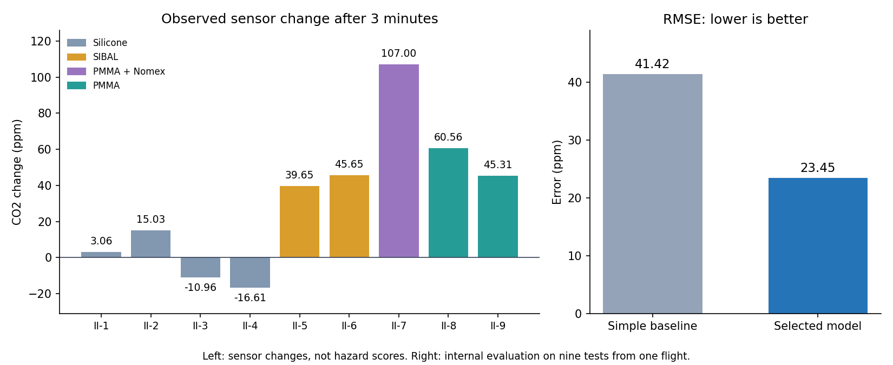

# Saffire-II analysis report

Generated from [analysis-saffire.json](analysis-saffire.json). For a shorter explanation, start with [SAFFIRE_EXPLICADO.md](SAFFIRE_EXPLICADO.md).

The archive contains 218 physical files (33.810 decimal GB), nine Saffire-II ignition records and one flight. The investigation identifier is PSI-99.

Dataset source: Urban DL, Ruff G. "Spacecraft Fire Experiment-II(SAFFIRE-II)", NASA PSI Data Repository, Version 5, [http://doi.org/10.60555/2chp-m469](http://doi.org/10.60555/2chp-m469).

## What was extracted and why

The workflow extracts pre-ignition conditions, electrical events, fixed-window CO2, O2, pressure, relative radiation and local temperatures. It also preserves published material outcomes and unaligned mission-level cabin statistics. Each test-level value has a source, channel, method, selection reason, interpretation and uncertainty or missing-value reason in [metrics.csv](data/processed/metrics.csv).

The predictive target is `co2_increase_180s_ppm`: median CO2 at [150,180) seconds minus the median at [-30,0), using one-second medians. It provides nine comparable rows. It describes a local signed sensor response, not total emission, toxic dose or fire power.

Only two published numeric spread rates exist, so they are retained as evidence rather than used to train a general propagation model. HRR, alarm delay, exposure hazard indices and ventilation-cutoff effectiveness lack the required channels, calibration, synchronization or interventions. Images were sampled for visual inspection without inventing a front trajectory. Duplicate ZIPs and image variants add no modeling rows.

## Validation and unresolved measurement issues

All nine electrical pulse durations agree with published commands within the fixed 0.15 s tolerance. Measured II-6 airflow is near 25 cm/s rather than the CSV's 20 or planning documents' 30; the postflight report corroborates 25. SIBAL length/duration differs by roughly 3-5% from the published spread rates, a bookkeeping comparison rather than independent optical validation. See [VALIDATION.md](data/processed/VALIDATION.md).

The derived ignitor energy requires a channel-scale review: the archived voltage/current product gives about 26-112 kJ, while nominal power and duration imply 0.736 or 2.910 kJ. Pulse-timing agreement does not validate this absolute energy magnitude. Calculated energy was neither an input nor the target of the model.

## AutoResearch evaluation and results

The experiment used fixed leave-one-test-out evaluation with seed 164, 15 attempts and a maximum budget of 15. Each held-out response was predicted using only the other eight tests. There is no independent flight test set. All error metrics below are in ppm of the signed sensor response.

| Model | RMSE | MAE | Maximum absolute error | Parameters |
|---|---:|---:|---:|---:|
| Training-mean baseline | 41.416407 | 34.448808 | 84.292567 | 1 |
| group_huber20_inverse_flow | 23.450696 | 17.827874 | 56.360005 | 2 |

The selected model's mean absolute held-out error is about 17.83 ppm. RMSE gives larger misses more weight. Its reduction of 43.38% relative to the baseline is not a percentage of correct predictions or a safety percentage. Repeated model selection on the same CV makes the selected error optimistic.

### Recorded attempts

| Attempt | Commit | Model | RMSE | Parameters | Decision | Description |
|---:|---|---|---:|---:|---|---|
| 1 | 96e465683d | training_mean | 41.416407 | 1 | keep | Baseline: training-fold mean, one parameter |
| 2 | b6388f9151 | ols_non_silicone | 25.472331 | 2 | keep | Two-parameter material-regime OLS: silicone versus carbonaceous specimens |
| 3 | 5c454d4657 | ridge_non_silicone | 27.231740 | 2 | discard | Ridge shrinkage alpha=1 on the same two material-regime parameters |
| 4 | b2afaf31e8 | ols_sibal_pmma_pmma_nomex | 38.847591 | 4 | discard | Separate material offsets; singleton composite uses training-only minimum-norm fallback |
| 5 | 383070fe3f | ridge_sibal_pmma_pmma_nomex | 39.516144 | 4 | discard | Ridge alpha=1 regularizes four material-category parameters |
| 6 | b14aa78138 | ols_non_silicone_silicone_log_thickness_sign | 25.976581 | 3 | discard | Add silicone log-thickness sensitivity constrained nonpositive; three parameters |
| 7 | c6a599ba7b | group_median | 25.305249 | 2 | keep | Two robust material-regime medians; reduce outlier influence without extra parameters |
| 8 | c2817cb9de | group_huber20 | 24.019803 | 2 | keep | Two material-regime Huber locations with fixed 20 ppm residual transition |
| 9 | 1b80c40066 | group_trimmed_mean | 24.471407 | 2 | discard | Two material-regime trimmed means when at least four training records exist |
| 10 | 2b40c5be54 | ols_organic_dilution | 25.064224 | 2 | discard | Two-parameter inverse-flow dilution response for non-silicone specimens |
| 11 | 67b987bb81 | ols_organic_flow | 27.376369 | 2 | discard | Two-parameter flow-proportional fuel-supply response for non-silicone specimens |
| 12 | 5b2c53df86 | ols_non_silicone_long_ignition | 29.438434 | 3 | discard | Material regime plus known ignition pulse duration; three coefficients |
| 13 | e8981b13de | ols_non_silicone_opposed | 25.558720 | 3 | discard | Material regime plus opposed-flow offset; three coefficients |
| 14 | 704266fa27 | ridge_non_silicone_log_thickness | 29.871495 | 3 | discard | Ridge material regime and logarithmic nominal thickness; three coefficients |
| 15 | 2af682a966 | group_huber20_inverse_flow | 23.450696 | 2 | keep | Huber material regimes with fixed inverse-flow dilution; two fitted parameters |

### Selected formula

```text
delta_CO2_180_ppm = silicone_location if material == Silicone else non_silicone_location * (20 / flow_cm_s)^1
{"non_silicone_location": 55.61162158009801, "silicone_location": -2.3719876375000006}
```

The displayed coefficients are fitted on all rows after calculating the held-out predictions. CV errors come from the held-out predictions, not from this full-data fit. The inverse-flow exponent is fixed rather than estimated as a universal physical law. Only one test has the higher flow, and one has PMMA-Nomex; their held-out folds lack matching cases.

## Findings by challenge objective

### Identify relevant fire-safety evidence

- **K1 (high confidence):** The 218 physical files contain nine measured Saffire-II tests, locally identified as PSI-99. They do not provide six independent mission datasets. Evidence in the detailed JSON: `/data_inventory_summary/n_files`, `/data_inventory_summary/missions_found`, `/data_inventory_summary/identified_psi_investigation`
- **K2 (medium confidence):** Pre-ignition pressure spans 102.50-102.76 kPa and sensor O2 spans 21.52-21.80%. Atmospheric similarity favors the assumed ISS/Gateway scenarios. Evidence in the detailed JSON: `/findings/habitat_atmosphere`, `/relevance_ranking/environment_assumptions`, `/relevance_ranking/environments`
- **K3 (medium confidence):** Lunar, Mars and rover relevance remains conditional: no local test validates low-pressure, enriched-O2 or partial-gravity transfer. Evidence in the detailed JSON: `/findings/habitat_atmosphere/observed_gravity_g`, `/relevance_ranking/limitations`

### Prepare and evaluate predictive data

- **K4 (low confidence):** The nine-test pilot has selected leave-one-test-out RMSE 23.45 ppm, versus 41.42 ppm for the training mean. Repeated selection on this same evaluation requires external validation. Evidence in the detailed JSON: `/autoresearch/n_rows`, `/autoresearch/baseline/val_rmse`, `/autoresearch/best/val_rmse`, `/predictive_model/cv_predictions`
- **K5 (low confidence):** The two SIBAL tests publish 2.1 and 2.6 mm/s at measured airflow 19.99 and 24.99 cm/s. The 23.8% rate increase is descriptive, with n=2. Evidence in the detailed JSON: `/findings/materials/sibal_spread_rates_mm_s`, `/findings/materials/sibal_flow_cm_s`, `/findings/materials/sibal_relative_speed_increase`
- **K6 (medium confidence):** Pre-test CO2 ranges from about 3307 to 4334 ppm. Subtracting each local baseline avoids attributing all pre-existing CO2 to the current test. Evidence in the detailed JSON: `/findings/detection_and_products/co2_pre_ppm_range`, `/tests/0/results/co2_increase_180s_ppm/method`

### Inform fire-safety controls and equipment

- **K7 (medium confidence):** All 4 silicone specimens showed no sustained propagation under these conditions. The supplied 1g comparisons reinforce the need to preserve material, gravity, ventilation and geometry when interpreting prevention evidence. Evidence in the detailed JSON: `/findings/materials/silicone_tests`, `/findings/materials/silicone_no_sustained_spread`, `/tests/0/results/ground_burn_length_label`, `/tests/3/results/ground_burn_length_label`
- **K8 (low confidence):** Cygnus smoke signals exist, but alarm thresholds/events and verified clock alignment are missing. Per-test detection delay and safe crew exposure time cannot be calculated. Evidence in the detailed JSON: `/findings/detection_and_products/smoke_records_present`, `/findings/detection_and_products/alarm_delays_s`, `/findings/cabin_impact/note`
- **K9 (medium confidence):** Paired inlet/outlet O2 with mass flow and a documented flow-cutoff intervention are missing. This archive alone cannot establish total HRR or suppression effectiveness. Evidence in the detailed JSON: `/tests/0/results/hrr_peak_kw`, `/findings/suppression`

## Habitat relevance

Scores rank evidence relevance under illustrative analyst scenarios, not ignition probability or material danger. Habitat atmosphere values are not official mission requirements. All experimental samples are small and all local tests are in microgravity.

| Scenario | Assumed O2 (%) | Assumed pressure (kPa) | Assumed gravity (g) | Leading test | Score /100 |
|---|---:|---:|---:|---|---:|
| ISS-like spacecraft | 21.0 | 101.3 | 0.000 | II-5 | 95.08 |
| Lunar base | 34.0 | 56.5 | 0.165 | II-5 | 50.88 |
| Pressurized lunar rover | 34.0 | 56.5 | 0.165 | II-5 | 50.88 |
| Mars base | 26.5 | 70.3 | 0.380 | II-5 | 63.55 |
| Gateway-like station | 21.0 | 101.3 | 0.000 | II-5 | 95.08 |

The complete ranking, weights and transfer limits are in [DATA_PLAN.md](DATA_PLAN.md) and the detailed JSON. Small score differences do not establish scientifically significant ordering.

## Figures



The left panel compares signed local CO2 responses. The right compares baseline and selected-model RMSE; smaller is better. Neither panel directly measures fire hazard. [README.md](README.md) explains the CO2 calculation windows, published SIBAL rates, local thermocouple coverage and camera samples.

## Limitations

- Nine test records in one flight; no independent flight validation or randomized replicates
- Model selected by repeated LOOCV; reported best error has selection optimism
- A single PMMA-Nomex composite test cannot validate material-specific generalization
- Material, geometry, sample location, flow and ignition energy are confounded
- Only two quantitative published spread rates; no independently calibrated optical-front extraction
- Sensor offsets and mixing dominate some small CO2 responses; negative changes are not physical CO2 consumption
- Uncertainty describes window variability, not absolute sensor accuracy or a confidence interval
- No CO, acid gas or particle-mass channels and no applicable exposure/alarm thresholds
- Cygnus clock alignment is unverified; mission telemetry cannot be assigned to per-test alarm delays
- No HRR from oxygen consumption without paired channels/mass flow or validated cabin mass balance
- No controlled ventilation cutoff or extinguishment effectiveness measurements
- No enriched-O2/low-pressure or lunar/Martian partial-gravity experiments in this archive
- Rankings use illustrative analyst atmosphere assumptions and subjective weights, not mission requirements
- Reported damage length, fuel regression, flame tip and pyrolysis propagation are different physical quantities

## Reproduce or restore the reports

With the processed CSVs and preserved experiment records available, this command recreates the detailed JSON, the English analysis report, the dashboard summary and the plain-language explanation:

```bash
.venv/bin/python analysis/build_analysis_json.py
.venv/bin/python -m pytest -q
```

To repeat extraction, obtain the cited raw archive, set `SAFFIRE_RAW_DATA` and run `extraction/run_all.py`. Raw data remain excluded from Git. JSON exports, reports, CSVs, figures and run records are included in the publication.

The historical experimental comparison `baseline-v1..2af682a96609f938a023eb5bf94d62441d4e0d4d` contains only `train.py`. Later English documentation and report generators preserve that completed model search.
